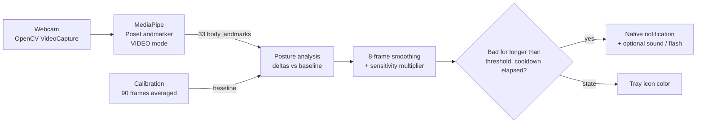

# PostureGuard

[](https://www.producthunt.com/posts/postureguard)

A local-first desktop app that watches your posture through the webcam with MediaPipe pose estimation and alerts you when you slouch, without ever storing a frame.


## What it does

- On launch, shows a short calibration window (~3 seconds) where you sit straight; that becomes **your** baseline.
- Then runs silently in the background with a system tray icon (green = good, red = bad, yellow = paused).
- When bad posture is sustained for a configurable time, sends a native OS notification, rate-limited by a cooldown.
- Optional "extreme alert": a random alert sound and/or a 400 ms full-screen red flash.
- Tray menu: Pause / Resume (releases the camera while paused), Recalibrate, Settings, Quit.

### What it detects

Every check is a delta against your calibrated baseline, not a fixed body-proportion rule:

| Check | Signal |
|---|---|
| Slouching | Shoulder midpoint drops |
| Hunching | Shoulder width narrows (shoulders roll inward) |
| Uneven shoulders | Shoulder line tilt increases |
| Head forward (neck gap) | Nose-to-shoulder vertical gap changes |
| Leaning | Nose drifts sideways from the shoulder midpoint |
| Head tilt | Ear line tilt increases |
| Forward head (CVA) | Craniovertebral angle (ear midpoint vs shoulder midpoint) decreases |

## Privacy

**No images are stored and nothing leaves your machine.**

- Frames are read from the webcam into memory, converted to pose landmarks, and discarded. The code never writes frames to disk (no `imwrite`, no `VideoWriter`) and the package makes no network calls.
- The only network request is the one-time download of the MediaPipe model file during setup (the prebuilt Windows release already bundles it).
- The only file the app writes is a small settings JSON (cooldown, sensitivity, alert toggles).
- The camera is released while monitoring is paused.
- `DEBUG=1` shows the live camera feed with a landmark overlay in a local window, for tuning only. It is off by default and records nothing.

The code is open source, so you can check every one of these claims.

## How it works



Frames are captured with OpenCV at roughly 15 fps (the loop sleeps between reads to save CPU) and passed to MediaPipe's `PoseLandmarker` (full model) in video mode. During calibration, about 90 frames of geometric features (shoulder height, width and tilt, head tilt, lateral lean, neck gap, craniovertebral angle) are averaged into a per-user baseline. In the main loop, the same features are compared to that baseline and averaged over an 8-frame rolling window, so a single noisy frame never triggers an alert. Thresholds are scaled by the sensitivity setting (low x1.6, medium x1.0, high x0.6).

A simple state machine turns per-frame results into alerts: bad posture must persist for `bad_posture_duration` seconds, and alerts are spaced at least `alert_cooldown` seconds apart. Notifications use the native mechanism on each OS: a PowerShell toast on Windows (falling back to `winotify`, then a tray balloon), `osascript` on macOS, and `notify-send` on Linux. Sound and flash run on daemon threads so they never block detection. Settings are re-read every frame, so changes in the Settings window apply without a restart.

## Download (Windows)

**[Download the latest release](https://github.com/MatheusDSantossi/posture-guard/releases/latest).** It is a single `PostureGuard.exe` that needs no Python install and bundles the pose model.

Releases are built by GitHub Actions on every `v*` tag (see `.github/workflows/release.yml`). Only Windows binaries are published; the macOS and Linux code paths exist but are not packaged.

## Quick start (from source)

Requires Python 3.10+ (CI and release builds use 3.11) and a webcam.

```bash
# 1. Download the pose model (~9 MB) into the project root
curl -L -o pose_landmarker_full.task \
  https://storage.googleapis.com/mediapipe-models/pose_landmarker/pose_landmarker_full/float16/latest/pose_landmarker_full.task

# 2. Install (a virtual environment is recommended)
pip install -e .

# 3. Run
posture-guard
# or
python -m posture_guard
```

Run it from the project root so the model file is found, or point `PG_MODEL_PATH` at it.

When the calibration window appears, **sit straight and look forward** for about 3 seconds. It closes on its own and monitoring continues in the background.

### Debug mode

Shows the camera feed with the skeleton and live metric values against their thresholds. Press `Q` to quit.

```bash
DEBUG=1 posture-guard          # bash / zsh
```

```powershell
$env:DEBUG=1; posture-guard    # PowerShell
```

The Makefile has shortcuts (`make run`, `make debug`, `make dev`) that use POSIX shell syntax, so on Windows run them from Git Bash or WSL.

## Configuration

### Settings window (tray, then Settings)

| Setting | Range / values | Effect |
|---|---|---|
| Notification cooldown | 5 to 120 s | Minimum time between alerts |
| Alert after bad posture for | 0.5 to 10 s | How long bad posture must last before alerting |
| Sensitivity | Low / Medium / High | Scales every threshold at once |
| Enable extreme alert | on / off | Enables the options below |
| Play alert sound | on / off | Plays a random `.wav` from `posture_guard/ui/assets/audio/` |
| Flash screen | on / off | 400 ms full-screen red overlay |

Settings are saved to `posture_guard_settings.json` in your user config folder: `%APPDATA%\PostureGuard` on Windows, `~/Library/Application Support/PostureGuard` on macOS, and `~/.config/posture-guard` on Linux.

### Environment variables

All detection thresholds can be overridden without code changes:

| Variable | Default | Description |
|---|---|---|
| `PG_SHOULDER_DROP` | `0.04` | Shoulder drop threshold (normalized) |
| `PG_SHOULDER_WIDTH` | `0.06` | Shoulder narrowing threshold (normalized) |
| `PG_SHOULDER_TILT` | `8.0` | Shoulder tilt delta (degrees) |
| `PG_HEAD_RISE` | `0.05` | Neck gap threshold (normalized) |
| `PG_FORWARD_LEAN` | `0.04` | Lateral lean threshold (normalized) |
| `PG_HEAD_TILT` | `10.0` | Head tilt delta (degrees) |
| `PG_FORWARD_HEAD` | `4.0` | Craniovertebral angle decrease (degrees) |
| `PG_VISIBILITY_MIN` | `0.5` | Minimum landmark visibility to use a point |
| `PG_BAD_DURATION` | `2.0` | Seconds of sustained bad posture before alert |
| `PG_ALERT_COOLDOWN` | `30.0` | Minimum seconds between alerts |
| `PG_CALIB_FRAMES` | `90` | Frames collected during calibration |
| `PG_LOOP_SLEEP` | `0.067` | Sleep between frames in seconds (about 15 fps) |
| `PG_MODEL_PATH` | `pose_landmarker_full.task` | Path to the MediaPipe model |
| `DEBUG` | `0` | `1` shows the camera window with metric overlay |

```bash
PG_BAD_DURATION=3 PG_ALERT_COOLDOWN=60 posture-guard
```

## Tech stack

| Component | Purpose | Version |
|---|---|---|
| Python | Runtime | 3.11 in CI and release builds |
| MediaPipe Tasks (`PoseLandmarker`) | Pose estimation | `>=0.10.0` (pinned `0.10.33` in `requirements.txt`) |
| OpenCV (`opencv-python`) | Camera capture, debug overlay | `>=4.8.0` (pinned `4.13.0.92`) |
| NumPy | Geometry and averaging | `>=1.24.0` (pinned `2.4.4`) |
| pystray + Pillow | System tray icon | `>=0.19.0` / `>=10.0.0` (pinned `0.19.5` / `12.2.0`) |
| winotify | Windows toast fallback | `>=1.1.0` (pinned `1.1.0`) |
| tkinter (stdlib) | Settings window, screen flash | bundled with Python |
| PyInstaller | Single-file Windows executable | `>=6.0` (pinned `6.19.0`) |
| GitHub Actions | Tag-triggered release build | `.github/workflows/release.yml` |

Minimum versions come from `pyproject.toml`. `requirements.txt` is a pinned Windows environment (it includes `pywin32`).

## Build the executable

The release workflow builds the executable from the PyInstaller spec, which bundles the model and the audio assets:

```bash
pip install -e ".[dev]"     # installs PyInstaller
# pose_landmarker_full.task must be in the project root (see Quick start)
pyinstaller PostureGuard.spec
# -> dist/PostureGuard.exe
```

## Project structure

```
posture-guard/
├── posture_guard/
│   ├── __init__.py          # version
│   ├── __main__.py          # python -m posture_guard
│   ├── main.py              # console-script entry point; resolves model path (incl. PyInstaller bundle)
│   ├── app.py               # main capture / detection / alert loop
│   ├── config.py            # constants, all env-overridable
│   ├── detector.py          # feature extraction, baseline, smoothing, posture checks (incl. CVA)
│   ├── calibration.py       # calibration window and baseline capture
│   ├── notifier.py          # native notifications per OS
│   ├── playsound.py         # random alert sound playback
│   ├── extreme_alert.py     # full-screen flash
│   ├── settings.py          # persistent user settings (JSON) and sensitivity presets
│   ├── tray.py              # system tray icon and menu
│   ├── utils.py             # resource path helper
│   ├── tests/               # unit tests for geometry helpers
│   └── ui/
│       ├── settings_ui.py   # tkinter settings window
│       └── assets/audio/    # alert sounds
├── .github/workflows/       # CI and release workflows
├── PostureGuard.spec        # PyInstaller build spec
├── pyproject.toml
├── requirements.txt
├── Makefile
└── LICENSE
```

## Why I built this

Most posture apps are intrusive, inaccurate, or send your camera data to the cloud. PostureGuard runs entirely on your machine, adapts to your own baseline instead of generic body proportions, and stays out of the way until you actually need a nudge.

## Releasing

The version lives in two places:

1. Bump `__version__` in `posture_guard/__init__.py`
2. Bump `version` in `pyproject.toml`
3. Tag and push: `git tag vX.Y.Z && git push --tags`, which triggers the release build

## License

[MIT](./LICENSE)
